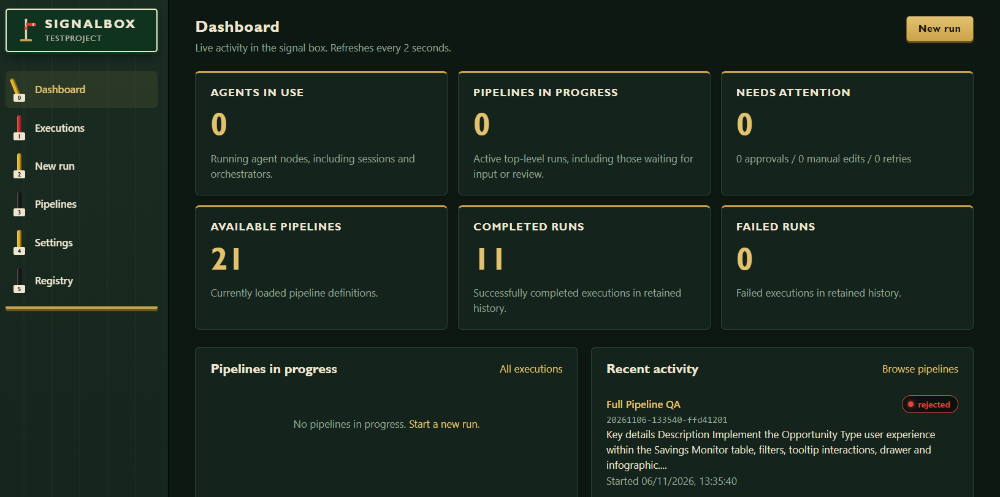
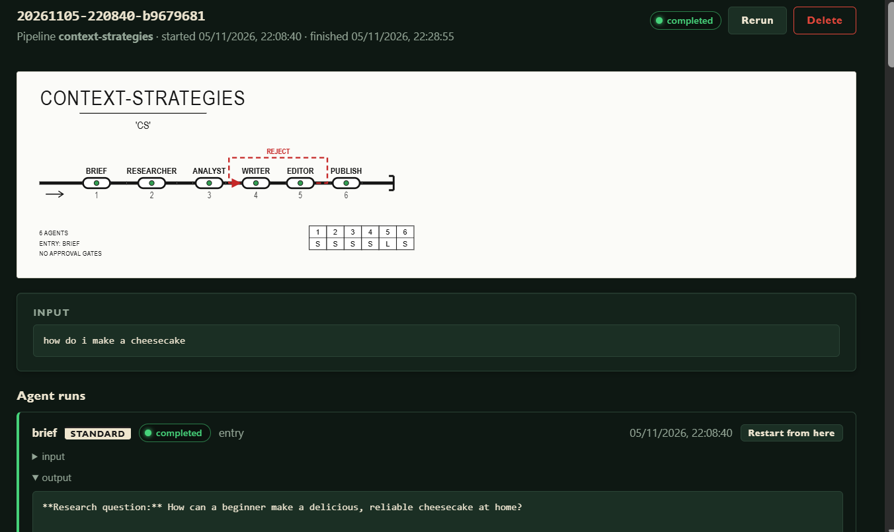
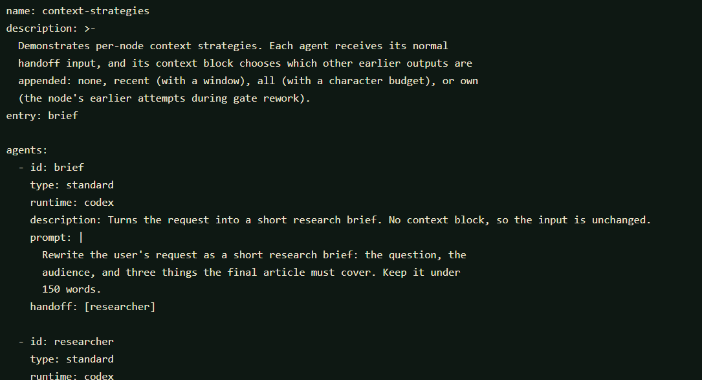

# SignalBox

SignalBox is a YAML based AI agent workflow system with human approval stages.
You describe a pipeline of agents in YAML, point each agent at a runtime
(Codex, Claude, Copilot, or any OpenAI-compatible API), and SignalBox executes
the chain, pausing at approval gates for review in the web UI or terminal.
Pipelines can also execute local code, send rejected work back for revision,
and start automatically from command-based watchers.

Built in Go with the web UI embedded in the executable. External agent CLIs
and script interpreters are installed separately when needed.

## Concepts

### Agent types

| Type | Behaviour |
|------|-----------|
| `standard` | Accepts a handoff (or several; see joins below), runs its prompt against a runtime, then hands off to one or more agents or a single orchestrator. |
| `orchestrator` | A long-running coordinator. It accepts handoffs from **many** agents (fan-in: it waits until every inbound handoff has arrived), then runs its **stages** in order. Each stage dispatches to agents in parallel and collects the terminal output of every chain it started before moving on. A stage (or the orchestrator itself) can define a `prompt` to synthesise the collected results using the orchestrator's runtime. |
| `approval` | A human gate. Approval passes the payload through unchanged. Rejection follows `reject-to` when specified; otherwise it restarts work after the last upstream approved gate in the same stage/scope, or retries immediate upstream work. Reviewer notes are appended to the rework input. |
| `llm_gate` | An automated quality gate. It evaluates its input with the configured runtime and records an approve/reject decision and feedback separately from human approvals. Rejected work can be sent to `reject-to` for a bounded number of reworks. |
| `manual_edit` | Pauses for a person to edit the incoming payload in the web UI or terminal, then hands the edited text downstream. |
| `code` | Executes a local script with its input on stdin, then hands stdout to downstream nodes. No AI runtime is required. |
| `session` | A multi-round discussion between participant agents. Participants take turns, each seeing the transcript, until they reach consensus or the round limit. See [Sessions and chunks](#sessions-and-chunks). |
| `pipeline` | Runs another pipeline (or a section of it) by name as a linked child execution and hands off its final output. See [Pipeline chaining](#pipeline-chaining). |

### Handoffs

- A node's `handoff` list names the nodes that receive its output. Multiple
  targets run as parallel branches.
- Existing scalar targets such as `handoff: [review]` remain unconditional
  and keep their original behavior. Approval and `llm_gate` nodes can instead
  route by decision and construct downstream input from a small template:

  ```yaml
  - id: human_review
    type: approval
    handoff:
      - to: publish
        condition: on_approve
        input: "{{ output }}"
      - to: revise
        condition: on_reject
        input: |
          {{ input }}

          Reviewer feedback: {{ comment }}
  ```

  Conditions are `always`, `on_approve`, and `on_reject`, plus output-field
  comparisons on nodes with an output schema (see "Structured responses"). With no `condition`,
  a handoff keeps the legacy approval behavior (it runs after approval).
  `input` replaces the default output payload and supports only `{{ input }}`,
  `{{ output }}`, and `{{ comment }}`; it is literal text substitution, not an
  expression language. A handoff without `input` receives the node's output.
  Rejection branches can terminate or continue through acyclic routes.
  `reject-to` remains the option for routing work back through a rework loop.
- A handoff to an orchestrator must be the *sole* target.
- An agent with no `handoff` terminates its chain. Inside an orchestrator
  stage, a terminating chain hands its output back to the orchestrator;
  outside one, the output becomes a **result** of the execution.
- Chains of standard, code, approval, and manual-edit nodes can run inside orchestrator stages.
- **Joins:** when several agents hand off to the same standard, code, approval, or manual-edit
  agent, it waits for all of them and runs once on the combined input (each
  part headed `--- handoff from <agent> ---`). Joins are counted per scope:
  inside a stage, only handoffs from that stage's chains count. For example,
  two planners in a stage can both hand off to a judge, which then hands back
  to the orchestrator.
- **Manual editing:** set `type: manual_edit` on a node to pause a run and
  revise the complete incoming payload before it continues. Set `handoff` to
  the next node; the submitted text becomes that node's input. This step does
  not use a runtime or prompt.
- **Additional input:** an agent can name other nodes whose completed output
  it also needs. The engine waits for those outputs and appends each under an
  `--- additional input from <agent> ---` heading, alongside normal handoffs.
  For example, a judge can receive planner handoffs plus the original
  requirements:

  ```yaml
  - id: judge
    runtime: codex
    additional-input: [requirements_loader]
  ```
- **Formatted output:** set `format: true` on an agent to render its Markdown
  output in the execution detail view. The raw Markdown remains available in a
  collapsible section; raw HTML in Markdown is not rendered.
- **Rejection target:** an approval or `llm_gate` can set `reject-to` to rerun
  an earlier node, or start a rejection-only branch:

  ```yaml
  - id: human_review
    type: approval
    reject-to: reformatter
  - id: reformatter
    runtime: codex
    prompt: Reformat the reviewed content using the reviewer feedback.
    handoff: [human_review]
  ```

  A rejection-only branch does not run before the first review. On each
  rejection, it receives the latest reviewed payload plus the rejection notes
  and follows its handoffs back to the approval. These branches can fan out
  and join without waiting for earlier normal-flow handoffs. An earlier node
  in the normal flow instead reuses its saved input plus the rejection notes.

  Targets must be non-orchestrator nodes in the same stage/scope, with handoffs
  leading back to the rejecting gate. Normal handoff cycles remain invalid; only
  rejection routes may loop backward. Diagrams place rejection-only work and
  dashed red rejection routes above the normal track, with return connectors
  back to review. Without `reject-to`, automatic checkpoint behavior remains
  unchanged. Rejections remain visible in the execution timeline; a later
  successful review can still complete that execution.

### LLM quality gates

An `llm_gate` is a distinct automated decision step. Its `prompt` describes
the evaluation criteria; the configured runtime receives the node's input and
is instructed to return exactly one JSON object with `decision` (`approve` or
`reject`) and `feedback` (a string). Invalid verdicts fail clearly instead of
being treated as approval.

```yaml
- id: quality_review
  type: llm_gate
  runtime: codex
  prompt: Check factual accuracy and completeness.
  max_reworks: 2
  reject-to: writer
  handoff: [publish]
```

The gate passes its input onward when approved. A rejection appends its
feedback to the rework input and invokes `reject-to`; after the configured
number of reworks, another rejection ends the execution with a clear
`rework limit` error. `max_reworks` is between 0 and 10; it must be positive
when automatic gate rework is configured. The execution record and UI show
LLM verdicts and feedback independently of human approval metadata.

### Structured responses

Put JSON Schema files (`.json`, `.yaml` or `.yml`) in the project's
`schemas/` directory (`schemas_dir` in `signalbox.yaml`) and reference them by
file name without the extension. A standard, code or `llm_gate` node's
`output.schema` makes its answer a validated JSON document; a pipeline's
`input.schema` validates the execution input before anything runs.

```yaml
name: structured-triage
input:
  schema: ticket            # schemas/ticket.json; non-matching input is refused
entry: triage
agents:
  - id: triage
    runtime: codex
    prompt: Classify the ticket.
    output:
      schema: triage        # schemas/triage.json
      on_invalid: repair    # repair (default for agents) or fail (default for code)
      max_repairs: 2        # 0-10, default 2
    handoff:
      - to: on_call
        condition: output.severity == "high"
        input: "Escalation: {{ output.summary }} (first owner {{ output.actions.0.owner }})"
      - to: support_queue
        condition: output.severity != "high"
```

- **Validation.** Schemas default to JSON Schema 2020-12 (set `$schema` for
  another draft). Local `$ref`s such as `#/$defs/...` work; references to other
  files or URLs are refused. `signalbox validate` checks every schema file.
- **Extraction.** The answer may be bare JSON, a fenced ```` ```json ```` block,
  or prose around one JSON value; the first document found is validated. On
  success the run's output is replaced with the document as indented JSON.
- **Repair.** With `on_invalid: repair`, an invalid answer is sent back to the
  same node with its original input, the rejected answer, and the validation
  errors (each as `at /json/pointer: message`). After
  `max_repairs` invalid repairs the run fails with the errors.
  `on_invalid: fail` fails on the first invalid answer. Runtime retries still
  apply to each call; schema failures are not retried automatically. Code
  steps receive the repair text on stdin, so a script can react to it.
- **Runtimes.** CLI runtimes (`codex`, `claude`, `copilot`, `cli`) get the
  schema and a "reply with JSON only" instruction appended to the prompt.
  `openai` also sends it as `response_format` (`json_schema`, non-strict);
  SignalBox still validates the answer. The `mock` runtime returns a sample
  document generated from the schema, so demos route on real fields.
- **Field routing.** A handoff `condition` can compare an output field with
  `==` or `!=` against a JSON literal (`"high"`, `'high'`, `3`, `true`,
  `null`): `output.severity == "high"`, `output.actions.0.owner != null`.
  Array elements are addressed by index. A missing field compares as `null`.
  Matching routes behave like unconditional handoffs; if none match, the
  output becomes a result of the execution.
- **Templates.** Handoff `input` templates can use `{{ output.path }}`
  alongside `{{ input }}`, `{{ output }}` and `{{ comment }}`. Strings are
  inserted as-is; objects and arrays as compact JSON; missing fields as empty
  text. Field conditions and templates need `output.schema` on the node.
- **Gates.** On an `llm_gate`, the schema describes the verdict. It must
  still carry the string fields `decision` (`approve`/`reject`) and
  `feedback`, and may add others (scores, issue lists). `output.*` conditions
  and templates on a gate read the verdict, and field-conditioned routes run
  only on approval. `{{ output }}` remains the input the gate passes on.

Each run records the schema and every validation attempt (errors and, for
invalid attempts, the rejected answer). The web UI shows a schema badge on
the run, the checks with their errors, and gate verdicts; the Pipelines page
shows each node's contract and lists the project's schema files with the
pipelines that use them. Registry packages bundle the schema files their
pipeline uses and install them into the consumer's `schemas_dir`.

Demos: `structured-triage` (input schema, field routing, templates and a
schema-validated gate verdict; start it with
`{"customer": "Acme", "summary": "Invoice total does not match the order"}`)
and `structured-repair` (a script whose invalid answer is repaired from the
validation errors).

### File uploads

An execution can carry files: attach them in the New run form (drop zone or
browse), with `signalbox run|start --file path` (repeatable), or as
`multipart/form-data` on `POST /api/executions`. Files are validated before
the execution is created, so a bad upload never starts a run, and are stored
read-only under `<state_dir>/uploads/<execution>/files/`.

A pipeline can declare what it accepts; all keys are optional:

```yaml
files:
  required: true            # refuse runs without files
  max_count: 3              # at most this many (default: uploads.max_files)
  extensions: [.csv, .md]   # narrower than uploads.allowed_extensions
  schema: invoice           # .json/.yaml/.yml uploads must match schemas/invoice.json
params:
  ledger:
    type: file              # a file picker in the UI; value = the attached file's name
```

Nodes never see the files unless they ask, so existing pipelines are
unchanged. Set `files:` per node:

| `files:` | Nodes | Delivery |
|----------|-------|----------|
| `inline` | standard, code, llm_gate | Text files are appended to the input between `--- file: name ---` markers, up to `files_budget` characters (default 20,000). Longer files are truncated with a note; binary files and files past the budget are listed by name only. Works with every runtime, including `openai`. |
| `path` | standard, code, llm_gate | Read-only copies are placed in a per-run folder named by `SIGNALBOX_FILES_DIR`; agents get the folder and file list in their prompt, and `claude`/`copilot` also get `--add-dir`. Code steps read the folder from the environment. Not available on `openai` runtimes. |
| `inherit` | pipeline | The linked child execution receives this execution's files (hard-linked, not copied). Without it the child starts with none. |

Each run records which files it received, how, and whether any were
truncated; the execution page lists the files with size, type, schema check
and download links, and `signalbox show` prints them. **Rerun**, **Restart**
and inherited child executions reuse the original files (marked `reused`), and
deleting or pruning an execution removes its upload folder. Downloads are
always served as attachments with `nosniff` and a sandbox CSP, and only names
recorded on the execution resolve. Watchers cannot attach files, so a watched
pipeline may not set `files.required`.

Project limits live in `signalbox.yaml` (see below): `uploads.max_bytes` per
file (default 10 MiB), `uploads.max_files` per execution (default 10) and
`uploads.allowed_extensions` (defaults to common text, data, office and image
types). Names are reduced to a safe base name (paths, control characters and
Windows device names are stripped or escaped) and made unique per execution.
When running in Docker, uploads live in the state volume with the database.

Demos (sample files in `testproject/samples/`):

- `upload-review` — an agent reads files inline, `libs/file_stats.py` reads
  them by path, and a gate checks the result against the same files:
  `signalbox run upload-review --file samples/orders.csv --file samples/notes.md`
- `upload-invoice` — schema-validated JSON upload plus a `type: file`
  parameter: `--file samples/invoice-1042.json --param invoice=invoice-1042.json`
  (try `samples/invoice-bad.json` to see it rejected before the run starts)
- `upload-chained` — a pipeline node passes the files to `upload-review` with
  `files: inherit`.
- `manuscript-review` — editorial advice on one `.txt`, `.md` or `.docx`
  manuscript. `libs/manuscript_profile.py` builds a chapter map and prose
  statistics. Structure, character, prose, continuity and market editors then
  read the full text by path in parallel and return schema-checked notes
  (`schemas/editorial-notes.json`). A senior editor writes a prioritised
  editorial letter, a gate checks it against the manuscript, and a human
  editor signs it off or sends it back. This demo needs a CLI runtime because
  it uses `files: path`:
  `signalbox run manuscript-review --file samples/manuscript-sample.md --param genre="literary mystery" --input "Worried the middle drags."`

### Runtime retries

Callable nodes can retry runtime errors automatically with a fixed delay:

```yaml
- id: researcher
  runtime: codex
  retry:
    count: 2
    backoff: 500ms
```

`count` is the number of retries after the initial call (0–10), and `backoff`
is a Go duration from 0 to 5 minutes. Cancellation interrupts the delay.
After automatic retries are exhausted, the existing `waiting_retry` action
remains available to retry the call manually or cancel the execution. Runtime
errors are separate from quality-gate rejection and code-node rejection
outcomes; automatic retries do not treat those decisions as transient failures.

The test project's `discovery` pipeline demonstrates conditional handoffs,
payload templates, an `llm_gate` with bounded rework, and runtime retries. The
`Full Pipeline QA` pipeline puts an `llm_gate` after each of ten specialist
planners, retaining two bounded reworks per planner. Local templates share
runtime/retry settings, and planners plus category judges use the
`qa-test-plan` schema with bounded repair. Tests include requirement references,
actionable steps and P0-P3 priorities; empty test lists require a justified
exclusion. Schemas check structure, while gates check relevance and coverage
against the requirements summary. Gates pass that requirements context through
to category judges, so judges do not append another copy.

The master judge consolidates a draft for a Three Amigos session: Business,
Developer, then QA take round-robin turns for at most two rounds, requiring
unanimous agreement. They review concise findings and corrections by test/REQ
ID rather than repeatedly rewriting the plan. QA summarizes agreed changes,
unagreed proposals and dissent; a final presenter receives both the draft and
review findings, preserves full test details, and applies agreed corrections.
Both consensus and no-consensus routes reach human approval, with the latter
explicitly marked as requiring human resolution. Model agreement is not a
substitute for human approval.

Human rejection sends the latest reviewed plan and feedback to a revision
agent, then repeats the Three Amigos session and presentation without rerunning
specialist planning or the original consolidation. Revisit upstream planning
separately when feedback requires new specialist analysis. A successful first
pass uses 32 LLM calls for one round, or 35 for two, excluding retries, schema
repairs and quality reworks. Jira retrieval still
requires suitable tools in the configured runtime; a prompt alone does not
provide a Jira integration.

### Context strategies

By default a node receives only its handoff input (plus any
`additional-input`). A `context` block appends selected **earlier outputs from
the same execution** to the text sent to the runtime:

```yaml
- id: editor
  type: llm_gate
  runtime: codex
  context:
    strategy: all        # none | all | recent | own
    max_chars: 12000     # optional budget; 0 or omitted means no limit
- id: analyst
  runtime: codex
  context:
    strategy: recent
    window: 2            # recent: default 1; own: default 0 (every earlier output)
```

| Strategy | Context contains |
|----------|------------------|
| `none` (default) | Nothing. The input is exactly as before. |
| `all` | Every eligible earlier output, oldest first. `window` is not accepted. |
| `recent` | The latest `window` eligible outputs (default 1). |
| `own` | This node's own earlier outputs in the execution, for example drafts that a gate rejected (latest `window` if set). |

Exact rules:

- **Eligible outputs** come from completed `standard`, `code`, `session`,
  `orchestrator`, and `manual_edit` runs with non-empty output. Approval and
  `llm_gate` runs are excluded, because they pass their input through
  unchanged. Failed, running, and canceled runs are excluded.
- Outputs are ordered by completion time. An output that already appears
  verbatim in the node's input (its handoff payload, a joined input, or an
  additional input) is **skipped**, so context never repeats what the node
  already receives. `window` applies after skipping.
- **`max_chars`** counts characters (Unicode code points) of the included
  outputs, not the headers. The budget is spent newest-first: newer outputs
  are kept whole, at most one older output is truncated (its beginning is
  kept), and anything older is dropped.
- The context is appended after the input in this format:

  ```
  <input>

  --- context (recent): 2 of 4 earlier outputs ---

  --- context from researcher (truncated to 1200 of 5000 characters) ---
  <first 1200 characters>
  [... 3800 characters truncated]

  --- context from writer ---
  <output>
  ```

  "2 of 4" means two of the four eligible outputs left after skipping. If
  nothing is selected, nothing is appended.
- Context is assembled once, when the run starts, and saved with the run
  (strategy, the included entries with their character counts, and the
  text). Manual retries and **Retry from here** reuse the saved context.
  Context is never part of the run's saved input, so gates and approvals
  pass their original payload downstream.
- `context` is supported on `standard`, `code` (the context is appended to
  stdin), `llm_gate`, and `session` nodes. On a session, it is added to every
  turn's input. Session participants cannot set it; set it on the session.
  `additional-input` is unchanged and works alongside context.

SignalBox makes no token-savings claims for these strategies. The
execution view shows how many characters each run's context added, so you
can measure the effect on your own pipelines. The `context-strategies` demo
pipeline uses all four strategies, `window`, and `max_chars`.

### Parameters

A pipeline can declare `params` and reference them as `${{ params.name }}`.
Values are chosen when a run starts (the **New run** form, `signalbox run
--param name=value`, or `"params"` in `POST /api/executions`), so one pipeline
can serve several variants.

```yaml
params:
  topic:
    required: true
    description: The subject of the briefing.
  audience:
    values: [engineers, executives]   # enum; rendered as a dropdown
    default: engineers
  depth: {type: integer, default: "3"}
  writer_model: ""                    # shorthand: string with this default
```

- Types are `string` (default), `integer`, `number`, and `boolean`. `values`
  restricts the value to a list. A param is either `required` or has a
  `default`, not both. A param with no default and not required is empty.
- References are substituted into the pipeline description, agent
  `description`, `prompt`, and `model`, `handoff` `input` templates, stage
  prompts, and chunk `initial` titles. Unknown references are validation
  errors; nothing else (IDs, runtimes, routes) can be parameterised.
- Values are validated before the run starts; unknown names, missing required
  values, and wrong types are rejected. Values are substituted as plain text.
- The resolved values are saved with the execution and shown on its page.
  **Rerun** and **Retry from here** reuse them. They are stored in plain
  text, so do not pass secrets as params.
- Watchers start runs with default values, so a watcher cannot target a
  pipeline with a required param that has no default.

Demo: `briefing-params`.

### Imports and templates

Agents can be shared between pipelines. `templates` are partial agent
definitions; an agent (or another template) inherits from them with
`extends` (a name or a list, applied in order). `imports` pull templates and
agents from another YAML file.

```yaml
imports:
  - from: ../shared/review-kit.yaml   # relative to this file
    templates: [gate_reviewer]        # omit to import all templates
    agents: [changelog_writer]        # omit to import all agents
templates:
  - id: strict_reviewer
    extends: gate_reviewer
    retry: {count: 2}
agents:
  - id: security_review
    extends: strict_reviewer
    prompt: Review for security problems only.
    reject-to: implementer
```

- Merging: maps (such as `retry` and `context`) deep-merge, and scalars and
  lists in the child replace the parent's. A child that sets
  `context: {strategy: none}` still inherits the parent's `window`, which
  fails validation, so set `window: 0` (and `max_chars: 0`, if inherited)
  explicitly when overriding.
- Imported files hold `templates` and/or `agents` and may import others.
  Shared files should live outside `pipelines_dir` (for example `shared/`), so
  they are not loaded as pipelines. Local agents come first, followed by
  imported agents in import order.
- Errors are reported for import or `extends` cycles (with the chain), more
  than 10 levels of nesting, duplicate agent or template IDs across files,
  unknown templates or selected agents, and non-YAML files.
- Imports must stay inside the project directory (symlinks are resolved)
  unless `allow_external_imports: true` is set in `signalbox.yaml`.
- The **Pipelines** page lists each pipeline's imported files. A change to a
  shared file is picked up the next time pipelines reload.

Demo: `review-kit` with `shared/review-kit.yaml`.

### Pipeline chaining

A `type: pipeline` node runs another loaded pipeline, looked up by its
`name`, as a linked **child execution**. Imports copy agent definitions into
a pipeline; chaining runs another pipeline as it stands, with its own
execution page.

```yaml
  - id: review_copy
    type: pipeline
    pipeline: content-line   # name of the pipeline to run
    from: draft              # optional: start here instead of its entry
    until: signoff           # optional: stop after this agent
    params:                  # optional: values for the child's params
      topic: ${{ params.subject }}
    retry: { count: 1, backoff: 2s }
    handoff: [collate]
```

- **Input and output.** The child gets the node's input (including any
  `additional-input`) as its run input. When it completes, its final output
  is handed off. If it has several final outputs, they are joined and
  labelled by agent.
- **Sections.** `from` and `until` must be top-level agents of the child
  (not ones reached only inside a stage or session), and `until` must be
  reachable from the start through handoffs.
  - `until` only stops that agent's handoffs. Parallel branches that bypass
    it still run, and their outputs are included.
  - Agents in the section cannot take `additional-input` from agents outside
    it.
- **Params.** `params` values may use the parent's own
  `${{ params.x }}`. Each key must be declared by the child, and the child's
  required params must be supplied.
- **Approvals surface on the parent.** Approvals, manual edits, and failed
  calls waiting in a child (or grandchild) are listed on the parent's page
  under **Waiting in linked pipelines**. You can handle them there, from
  `signalbox approve|reject|edit|retry <parent-id>`, or from the parent's
  API endpoints with the child run's `run_id`. Each run card for a pipeline
  node links to its child execution, and the child page links back to its
  parent.
- **Outcomes.**
  - **Completed child:** its output is handed off.
  - **Rejected child:** the node is rejected, and the usual rework rules
    apply in the parent. A rejection inside the child follows the child's
    own rules first; for example, rejecting an approval reworks the agent
    before it, so the child only ends rejected when nothing upstream remains.
  - **Failed or canceled child:** handled like a failed agent call. It is
    retried per the node's `retry` policy, then waits for a manual retry,
    which starts a fresh child execution. Earlier attempts stay linked.
  - **Canceled parent:** cancelling or failing the parent cancels its
    running children.
- **Restarts.** A child execution cannot be restarted or rerun on its own.
  Restart the parent from the pipeline node instead, which runs a new child.
  The parent's definition fingerprint does not include the child pipeline,
  so changes to the child do not trigger the changed-definition check.
- **Validation.** Errors are reported for:
  - unknown pipelines, `from`, or `until`;
  - undeclared or missing params;
  - reference cycles (for example `a -> b -> a`, including a pipeline that
    runs itself).

  Nesting is limited to 5 levels. Saving a pipeline in the editor is refused
  only for reference errors the save would introduce.
- **Registry.** Publishing a pipeline does not bundle the pipelines it
  references, so install those too.

Demos:
- `content-line`: the reusable line, with a param and a human sign-off.
- `chain-express`: runs all of `content-line` and passes params.
- `chain-section`: runs two sections of `content-line` in parallel, and
  surfaces the sign-off on the parent.

### Model overrides

Set AI call defaults per named runtime in `signalbox.yaml`:

```yaml
runtimes:
  codex:
    type: codex
    model: gpt-5.4
    reasoning_effort: high
    speed: standard
  claude:
    type: claude
    model: opus
    reasoning_effort: high
    speed: standard
  openai:
    type: openai
    model: gpt-5.4
    reasoning_effort: high
    speed: fast
    api_key_env: OPENAI_API_KEY
```

`model` is the default for all calls through that runtime, including session
participants, orchestrator synthesis, and structured-output repair calls.
An agent's `model` still takes precedence. Omitted settings preserve existing
provider/CLI defaults. Restart the server after changing runtime settings.

`speed` accepts `standard` or `fast`. Fast requests provider priority service,
**not** less reasoning or a cheaper model; it may incur additional charges and
requires provider/model/account support. Codex receives `service_tier`, Claude
receives a per-call `fastMode` setting, and OpenAI receives `service_tier:
priority` (`default` for standard). Provider rejection or CLI failure is surfaced
as a runtime error. Claude may apply its own fast-mode eligibility/cooldown rules.

`reasoning_effort` is independent of speed. Supported values:

| Runtime | Reasoning effort | Speed |
|---------|------------------|-------|
| `codex` | `none`, `minimal`, `low`, `medium`, `high`, `xhigh`, `max`, `ultra` | `standard`, `fast` |
| `claude` | `low`, `medium`, `high`, `xhigh`, `max`, `ultracode` | `standard`, `fast` |
| `openai` | `none`, `minimal`, `low`, `medium`, `high`, `xhigh` | `standard`, `fast` |
| `copilot` | Not supported by this preset | Not supported by this preset |
| `cli` | Requires `reasoning_effort_arg` | Requires `speed_arg` |

Actual effort levels depend on the selected model and installed CLI version.
Unsupported configuration fails validation rather than being silently ignored.
The Copilot preset supports `model`; it does not assume undocumented effort or
priority flags. For a custom CLI that supports those options, configure explicit
flags:

```yaml
runtimes:
  custom:
    type: cli
    command: my-agent
    model: my-model
    model_arg: --model
    reasoning_effort: high
    reasoning_effort_arg: --effort
    speed: fast
    speed_arg: --speed
```

Each configured flag receives its value as a separate process argument.

`standard`, `llm_gate`, and `orchestrator` agents can set `model` (it may use
a param). The `codex`, `claude`, and `copilot` runtimes pass it as
`--model`, `openai` uses it instead of the runtime's `model`, and `mock`
ignores it. A `cli` runtime needs `model_arg` (for example `model_arg:
--model`) or validation fails. Session participants use their own `model`.
The model is shown on each run card.

### MCP servers

Agents on `codex`, `claude`, and `copilot` runtimes can be given Model Context
Protocol servers. This is opt-in at two levels. The project registers servers
and the tools they may expose:

```yaml
# signalbox.yaml
mcp:
  enabled: true
  servers:
    github:
      command: github-mcp-server
      args: [stdio]
      env_from:
        GITHUB_PERSONAL_ACCESS_TOKEN: GITHUB_TOKEN   # server var: SignalBox env var
      tools: [search_issues, get_issue]
```

Then each agent names the servers (and optionally a subset of tools) it needs:

```yaml
agents:
  - id: triager
    runtime: claude
    mcp:
      - github                                  # all tools allowed above
      - server: docs
        tools: [search]
```

- For agent tool access, SignalBox does not host external MCP servers. For
  each call it passes only the granted servers and tools to the agent CLI:
  - **codex**: `-c mcp_servers.<name>.*` overrides with `enabled_tools`.
  - **claude**: `--mcp-config <file> --strict-mcp-config --allowedTools
    mcp__<name>__<tool>,...`.
  - **copilot**: `--additional-mcp-config @<file> --allow-tool
    '<name>(<tool>)',...`.
- Validation fails if MCP is not enabled, a server is not registered, a tool
  is not in the server's `tools`, the runtime is not codex/claude/copilot, or
  a wildcard is used. Session participants can use MCP; orchestrators cannot.
- **Security:**
  - MCP servers run as the user running SignalBox, with that user's access.
  - Secrets are never written in YAML: `env_from` names an environment
    variable that SignalBox reads at call time (a missing variable fails the
    call without showing values).
  - codex receives secret values through its environment (`env_vars`).
    claude and copilot receive them in a temporary JSON file, readable only
    by the current user and deleted after the call.
  - Runs record which servers and tools were granted, never environment
    values.
  - Only claude is told to ignore other MCP configuration
    (`--strict-mcp-config`). codex and copilot still load the user's own
    global MCP servers alongside the granted ones.

Demo: `repo-explorer-mcp`, using the read-only filesystem server registered
in `testproject/signalbox.yaml` (requires Node.js for `npx`).

### Sessions and chunks

A `session` node runs a conversation between **participants**: ordinary
`standard` agents that only the session invokes. Each round, every participant
takes one turn. Its prompt is its own `prompt` plus session instructions, and
its input is the session's input followed by the transcript so far (and the
chunk table, when chunks are enabled).

```yaml
- id: design_review
  type: session
  participants: [architect, security_reviewer, delivery_lead]
  turn_order: round_robin        # or moderator (moderator speaks first each round)
  # moderator: architect         # required with turn_order: moderator
  max_rounds: 4                  # 1–20, default 5
  summary_agent: delivery_lead   # optional; writes the session's output
  consensus:
    method: vote                 # vote (default) or moderator_decides
    keyword: "VOTE: AGREE"       # default; must appear on its own line
    require: majority            # all (default) or majority
    require_chunks_done: true    # optional; needs chunks.enabled
  chunks:
    enabled: true
    initial: [Agree the component boundaries]
  handoff:
    - to: sign_off
      condition: on_consensus
    - to: escalate
      condition: on_no_consensus
```

- **Consensus.** With `vote`, a participant agrees by writing the keyword on its
  own line (case-insensitive; `**bold**` is fine). A round reaches consensus
  when all, or more than half, of the participants agree in that round. With
  `moderator_decides`, only the `summary_agent` can end the session, by
  writing `CONSENSUS: REACHED`. With `require_chunks_done`, consensus also
  needs every chunk to be done; otherwise the discussion continues.
- **Output.** When the session ends, the `summary_agent` (if set) writes a
  final summary, which becomes the output. Without one, the output is
  Markdown minutes of the transcript.
- **Outcomes and routing.** A session ends with `consensus` or `no_consensus`.
  Handoffs with no condition, or with `on_consensus`, run on consensus;
  `on_no_consensus` routes run when the round limit is reached; `always` runs
  on either. If rounds run out and there is no `on_no_consensus` or `always`
  route, the execution is **rejected** with
  `session "<id>" reached max_rounds (N) without consensus`.
- **Participants** must be standard agents and belong to one session. They
  cannot be the entry, a handoff, `reject-to` or `additional-input` target, or
  a stage agent. They also cannot define their own `handoff`, `reject-to`,
  `additional-input` or `retry`; set `retry` on the session instead, which
  applies to each turn.
- **History and recovery.** Each turn is saved to the execution record (the
  run's `session` field) as soon as it completes, so transcripts survive
  restarts. **Retry from here** on an interrupted session resumes it in a new
  execution: completed turns are kept and not replayed, and chunks are copied.

**Chunks** are execution-scoped work items with stable IDs (`C-001`,
`C-002`, …). IDs are never reused, even after a chunk is removed. When a
session has `chunks.enabled`, participants manage chunks with directives,
each on its own line of their turn:

```
CHUNK_ADD: Write the migration plan
CHUNK_DONE: C-001
CHUNK_REMOVE: C-002
```

Titles must be one non-blank line of at most 200 characters, and each turn
can apply at most 20 directives. Invalid directives (an unknown ID, a blank
title, or an already-done chunk) are ignored and listed with the turn; they
do not fail the session. People can also manage chunks while the execution
is running, from the execution page, the API, or the CLI:

```bash
signalbox chunks list <execution>
signalbox chunks add <execution> Write the migration plan
signalbox chunks done <execution> C-001
signalbox chunks remove <execution> C-002
```

The CLI talks to the running server, using the address in `signalbox.yaml`
or `--addr host:port`. Use `--by name` to record who made the change. Chunks
become read-only once an execution finishes.

The test project includes two demos. `design-review` shows round-robin
voting with a majority, chunks with `require_chunks_done`, and
`on_consensus`/`on_no_consensus` routing. `incident-war-room` shows a
moderator with `moderator_decides`, where running out of rounds rejects the
execution.

### Code Steps

```yaml
- id: Verify
  type: code
  language: python
  code-source: libs/verify.py
  timeout_seconds: 30
  codes:
    success: 0
    fail: 1
    retry: 2
  handoff: [security_judge]
```

Connect an upstream node with `handoff: [Verify]`, or list the code node in an
orchestrator stage's `agents`. `code-source` is relative to the project directory
containing `signalbox.yaml`; scripts also run with that working directory.
Supported languages are `python`, `javascript` (Node.js), and `powershell`;
the corresponding `python`, `node`, or `powershell` command must be on `PATH`.
Scripts run locally with the server user's permissions, not in a sandbox.

The full assembled handoff input is sent as UTF-8 text on **stdin**, including
any `additional-input` sections. Write the result to **stdout** and diagnostics
to **stderr**. With `codes`, the mapped `success` hands stdout downstream and
`fail` immediately fails the execution. The mapped `retry` acts like rejection:
it restarts work after the last upstream approved gate in the same stage/scope,
or retries the immediate upstream agents if no earlier approval exists. Both
stdout and stderr become rejection feedback appended to the rework input.
The rejected code run remains in the timeline and does not hand off a result.
Without upstream work to retry, rejection ends the execution.

All three mappings are required when `codes` is present and must have distinct,
non-negative values. Without `codes`, nonzero exits retain the manual-retry
behavior. Unmapped exits and process errors (including timeouts) also pause
for manual retry. The script is reloaded on each call. Code steps share the
runtime concurrency cap and cancellation handling; the default timeout is
600 seconds.

For structured input, an upstream node can return JSON and the script can parse
it directly (without additional labeled handoff sections):

```python
import json
import sys

data = json.load(sys.stdin)
if not data.get("tests"):
    print("Validation failed: no tests supplied", file=sys.stderr)
    sys.exit(1)
print(json.dumps({"validated": True, "tests": data["tests"]}))
```

The QA example's `libs/verify.py` currently checks for non-empty planner output
and passes it through; replace its body with your validation rules.

### Runtimes

Configured in `signalbox.yaml` and referenced by name from agents:

| Type | Backing |
|------|---------|
| `openai` | Any OpenAI-compatible chat completions API (`base_url` configurable, key read from an env var). |
| `codex` | `codex exec "<prompt>"` (local CLI). |
| `claude` | `claude -p "<prompt>"` (local CLI). |
| `copilot` | `copilot -p "<prompt>"` (local CLI). |
| `cli` | Any custom command; prompt via final argument or stdin (`prompt_mode`). |
| `mock` | Deterministic echo for demos and tests. |

The CLI presets just set a default command/args — everything (command, args,
prompt delivery, timeout) is overridable per runtime.

By default the prompt is passed as the final argument. Windows limits a
command line to 32,767 characters, so a prompt longer than about 24,000
characters (e.g. a judge receiving every planner's output) is piped through
stdin instead for `codex` (`codex exec -`) and `claude` (`claude -p`). Other
runtimes fail with a clear error in that case; set `prompt_mode: stdin` if the
command can read its prompt from stdin.

## Getting started

Building from source requires Go 1.25 or newer. The scaffolded default pipeline
uses the `mock` runtime, so no AI credentials are needed to try it. For real
runtimes, install/authenticate the relevant CLI or set the API key environment
variable configured for the OpenAI-compatible runtime. Code steps require
their language's interpreter on `PATH`.

### Install from GitHub

```bash
go install github.com/kaladinstorm84/SignalBox/cmd/signalbox@latest

signalbox init my-project     # creates signalbox.yaml + pipelines/default.yaml
cd my-project
signalbox validate            # check config and all pipelines
signalbox serve               # web UI on http://127.0.0.1:8484
signalbox run default --input "Hello SignalBox"   # terminal run
```

The Go binary installation directory must be on `PATH` to invoke `signalbox`
directly. `serve` runs until stopped; use another terminal for `run`, or stop
the server first.

### Build and run locally on Windows

```powershell
git clone https://github.com/kaladinstorm84/SignalBox.git
Set-Location SignalBox
go build -o signalbox.exe ./cmd/signalbox
.\signalbox.exe init my-project
Set-Location my-project
..\signalbox.exe validate
..\signalbox.exe serve
```

Open `http://127.0.0.1:8484`. From the project directory, a terminal execution is
`..\signalbox.exe run default --input "Hello SignalBox"`. From the repository
root you can also use `go run ./cmd/signalbox` followed by a CLI command. Running
`go run .` is not supported because the entry point is in `cmd/signalbox`.

After changing Go source or the embedded UI, rebuild from the repository root
and restart the executable. Pipeline YAML is reloaded for new UI runs, but
runtime definitions and other project settings require a server restart.

`signalbox run` prompts for approvals on the terminal; pass `--yes` to
auto-approve every gate (useful in scripts/CI). Pass pipeline parameters with
a repeatable `--param name=value`. `signalbox serve --addr
127.0.0.1:8485` overrides the configured listen address; `signalbox version`
prints the build version.

## MCP server (`signalbox mcp`)

SignalBox can expose its running HTTP API to an AI client over MCP stdio.
This is separate from granting external MCP tools to pipeline agents: the
client controls SignalBox, while SignalBox continues to execute workflows.
The adapter does not start a second engine or own the lifetime of executions.

Start `signalbox serve` normally, then configure your MCP client to launch:

```text
signalbox mcp --url http://127.0.0.1:8484
```

Without `--url`, the command reads the server address from `signalbox.yaml`
in its working directory. An explicit URL lets the client run from anywhere.
The target must be an HTTP(S) origin, without credentials, paths, query
parameters or fragments. The API must already be running; connection failures
are reported on stderr. Stdout is reserved for MCP messages.

For example, a VS Code `.vscode/mcp.json` configuration (with `signalbox` on
`PATH`) is:

```json
{
  "servers": {
    "signalbox": {
      "type": "stdio",
      "command": "signalbox",
      "args": ["mcp", "--url", "http://127.0.0.1:8484"]
    }
  }
}
```

### Command tools

The tool list is stable: pipelines are resources, not dynamically generated
tools. Tools use the existing API's validation, child-execution routing,
recovery checks and error responses.

| Tool | Purpose |
|------|---------|
| `start_execution` | Start a named pipeline with `input` text, optional string-valued `params`, and optional `files` (`name`, `content_base64`). For schema-validated input, pass JSON encoded as text. |
| `cancel_execution` | Cancel a running execution. |
| `retry_run` | Retry a failed call awaiting retry, using `execution_id` and `run_id`. |
| `restart_execution` | Start a recovered execution with optional `run_id`, `node_id`, `stage`, and `force`. Definition-change conflicts are preserved; never automatically force them. |
| `rerun_execution` | Create another execution using the original input, parameters and files. |
| `add_chunk` | Add a work item with `execution_id` and `title`. |
| `complete_chunk` | Mark a work item done with `execution_id` and `chunk_id`. |
| `remove_chunk` | Remove a work item with `execution_id` and `chunk_id`. |

Tools publish input/output schemas and side-effect annotations. Successful
results include structured `execution_id`, `resource_uri`, `dashboard_url`
and the original API `response`, plus a resource link and a text representation
for compatibility. Creation acknowledges an execution, not completion.
Repeated starts/reruns/restarts create separate executions: there is no
idempotency key and the adapter does not retry ambiguous failures.

Attachments are supplied as contents, never local filesystem paths. Their
combined decoded size is limited to 8 MiB; the server's own upload count,
size, extension and pipeline rules still apply.

### Resources and templates

| URI | Content |
|-----|---------|
| `signalbox://meta` | Project name and upload limits. |
| `signalbox://pipelines` | Pipeline catalog with descriptions, parameters, input schema references and workflow nodes. |
| `signalbox://pipelines/{name}` | One pipeline's API projection. Individual pipelines also appear in resource discovery. |
| `signalbox://schemas` | Schema catalog, usage references and load errors. |
| `signalbox://schemas/{name}` | One schema document and its usage references. |
| `signalbox://executions{?page,page_size}` | Execution summaries; the API's pagination rules apply (default page 1, size 20). |
| `signalbox://executions/{id}` | Full API execution detail, including pending gates, child links and surfaced runs. |
| `signalbox://executions/{id}/results{?offset,limit}` | Final outputs, execution status, terminal flag and per-output resource links. |
| `signalbox://executions/{id}/approvals{?offset,limit}` | Pending human approval gates, including surfaced child gates, with review input, owning execution/pipeline/run/node IDs and execution resource links. |
| `signalbox://executions/{id}/runs/{run_id}/output{?offset,limit}` | A node run's output in Unicode-character pages (default limit 8192; maximum 65536). |
| `signalbox://executions/{id}/runs/{run_id}/transcript{?offset,limit}` | Session turns, round, votes and consensus outcome. |
| `signalbox://executions/{id}/chunks` | Current work items. |
| `signalbox://executions/{id}/files/{name}` | Attached file contents as a binary resource. |

Results, approvals and transcript pages default to 20 items, maximum 100. Paged derived
resources use zero-based `offset` and return `total` and `next_offset` (`null`
at the end). Resource contents are limited to 1 MiB and upstream responses
to 16 MiB. Oversized reads fail explicitly rather than silently truncating:
use smaller pages, paged run output, or the HTTP API/dashboard. In particular,
a single oversized transcript turn or execution record may require HTTP access.

The adapter polls the pipeline catalog and subscribed resources every two
seconds. It sends resource-list change notifications for pipeline discovery
changes and resource-update notifications for changed subscriptions,
including resources that become unavailable. Notifications are hints to
reread persisted state, not a durable event log or a promise to wake a model.
Disconnected executions continue running. Clients must support resource
discovery/reads for this resource-first interface.

### Watching approvals

Clients can subscribe to `signalbox://executions/{id}/approvals` without
`--allow-review`. Subscribe first, then read the current resource so the
client has an initial view even if nothing changes. For example, on MCP
protocol versions using `resources/subscribe`, the request parameters are:

```json
{
  "method": "resources/subscribe",
  "params": {
    "uri": "signalbox://executions/abc123/approvals"
  }
}
```

The adapter watches that URI automatically while connected. When an approval
appears, changes, or is resolved (including surfaced child approvals), it
sends a `notifications/resources/updated` notification identifying the URI.
The notification does not contain the approval payload: use `resources/read`
with that URI to retrieve the latest pending gates. Prefer subscribing to
the unpaged URI to track the pending count and first page; read additional
pages as needed.

Use the MCP client's subscription API where available: the SDK negotiates
the subscription mechanism for the client's protocol version. Unsubscribe
when no longer interested, and resubscribe and reread after reconnecting.
Updates are detected by the two-second polling loop, not sent as a durable
stream of every intermediate transition. Reading or subscribing never
resolves a gate or requires delegated review permission.

### Permissions and scope

Approval and manual-edit tools are **not exposed by default**. Reading or
subscribing to the approvals resource does not require
`--allow-review` and cannot resolve a gate. Resolved approvals disappear from
this pending-only view; historical decisions remain in execution detail.
Manual-edit and automated LLM gates are not included.

Explicitly launching with `--allow-review` adds `resolve_approval` (`execution_id`,
`run_id`, `approved`, optional `comment`) and `submit_manual_edit`
(`execution_id`, `run_id`, `output`). Review and chunk mutations record the
actor as `mcp-client`, not a human identity. Only enable delegated review
when your workflow policy permits it; otherwise use the dashboard.

This flag controls tool exposure, not HTTP authentication. The adapter has
the target API's authority and exposes all its pipelines and executions:
use it only with trusted clients and a trusted server, normally on loopback.
Pipeline starts can execute local code, consume model budget and use external
services. Do not automatically grant this server back to pipeline agents,
which could otherwise recursively launch workflows.

Settings, pipeline-file editing, registry administration and execution deletion
are not exposed. Prompts, elicitation, sampling and experimental MCP tasks are
not part of this interface.

## The web UI (`signalbox serve`)

- **Dashboard** — the default landing page, refreshing every two seconds.
  Shows running agent nodes (including sessions, orchestrators, and LLM gates,
  but not code, human gates, or pipeline junctions), top-level pipeline runs in
  progress, approvals/manual edits/retries needing attention, and the number of
  currently loaded pipeline definitions. Linked child runs contribute to agent
  and attention counts without counting the parent pipeline twice. Completed
  and failed totals cover retained execution history (including children), not
  just the latest page. Active runs and recent activity link to execution details.

  
- **Executions** — live list of every run with status and pending-approval
  badges; click through to a per-agent timeline showing inputs, outputs,
  orchestrator stages, and errors. The execution page includes a live pipeline
  diagram, centred status lights, and automatic diagram scrolling to active
  work. Running nodes are green, failures/retry waits/rejections are red,
  waiting nodes are amber, completed nodes are green, and canceled/interrupted
  nodes are gray.

  
- **New run** — pick a pipeline, preview its agent flow, and send an input
  into it. Opening New run (or clicking it again) reloads pipeline YAML from
  disk, so added and edited pipelines are available without restarting the server.
- **Pipelines** — a searchable board of station signs for the loaded definitions.
  Choose a sign to see just that pipeline's agents, types, runtimes, handoffs,
  and stages. A searchable, scrollable submenu under **Pipelines** lets you
  switch between definitions; **All pipelines** returns to the board and schemas.
  Pipeline detail links can be bookmarked, and **Run** preselects that pipeline.
  Use **New pipeline** to create a YAML file or **Edit** on a
  pipeline to modify its source. The editor writes to the configured
  `pipelines_dir`, preserves comments/whitespace, and validates the graph,
  runtime/code references, and duplicate pipeline names before saving.
  Filenames must be `.yaml` or `.yml` files, not paths. Existing filenames are
  read-only in the editor, and a new file never overwrites an existing one.
  Stale saves are rejected if the file changed on disk. **Reload** discards a
  draft and reads the current file; drafts survive navigation between pages.
  **Edit pipeline files** remains available when malformed YAML prevents
  pipeline loading, so invalid files can be repaired. The starter template
  uses `mock`; select a runtime defined in your project when adapting it.
  Successful saves are available to new runs without restarting the server.
- **Settings** — edit the project configuration as YAML. Saving validates the
  configuration, runtime definitions, and pipeline references while preserving
  comments and whitespace. Reload reads the current file from disk; a stale
  save is rejected rather than overwriting external edits. Restart the server
  after saving to apply runtime, concurrency, watcher, and server settings.
- New run, Pipelines, and execution details draw pipelines as track diagrams:
  agents that run one after
  another sit on a single line, while agents that run in parallel (orchestrator
  stages and handoffs to several agents) split onto parallel tracks that rejoin
  where their outputs are collected, including at an agent that joins several
  branches.
  Rejection-only branches sit above the main flow, with dashed red rejection
  arrows and return links to existing review nodes. Diagrams scroll within
  their containers on smaller screens; navigation stacks above the content
  on mobile.
- Approval gates surface directly in the execution view with
  approve/reject buttons and an optional comment.
  Rejection follows `reject-to` if configured. Otherwise, it sends work back
  after the last upstream approved gate in the same stage/scope, or retries
  the immediate upstream agents if there is no earlier approved gate. Notes
  are appended under `--- rejection notes from <gate> ---`. Without either an
  explicit route or upstream work to retry (for example, an approval is the
  entry), rejection ends the execution.
- When a runtime call fails, that run pauses as `waiting_retry` with a
  **Retry** button; parallel branches keep running, but nothing downstream of
  the failure proceeds. Retry re-invokes the agent with the same input; use
  **Cancel** to give up. `signalbox run` prompts `retry? [y/N]` instead (with
  `--yes`, failures are not retried and the execution fails). Code nodes with
  explicit `codes` mappings instead follow their configured success, terminal
  fail, or rejection-style retry outcome as described above.
- **Rerun** starts a new execution with the same pipeline and input, using the
  pipeline definition currently on disk. **Delete** removes a finished
  execution and its stored history; cancel a running execution first.
- Session runs show their transcript grouped by round, with ✓ marks on
  agreeing turns, any chunk directives each turn applied or rejected, and a
  consensus / no-consensus banner. Diagrams draw a session as an interchange
  with one ring per participant and list the participants below it.
  Executions with chunks show a **Chunks** table; while the execution is
  running you can add chunks, mark them done, or remove them.
- Runs with a `context` strategy show a **context** section listing the
  included earlier outputs, any truncation, and the exact appended text. The
  Pipelines table and diagram tooltips show each node's strategy.
- **Registry** — browse, inspect, install, and publish versioned pipeline
  packages when a registry is configured (see [Pipeline registry](#pipeline-registry)).

Execution history is persisted in `.signalbox/executions.db`, so it survives
restarts. Existing JSON records in
`.signalbox/executions/` are imported automatically the first time the database
opens. The default retention limit is 1,000 terminal executions; set
`execution_retention` in `signalbox.yaml` to change it, or to `0` to keep
history indefinitely. In-progress executions are not pruned.
Interrupted standard-agent, code, `llm_gate`, and session cards offer **Retry from here**,
which starts a new execution at that call with its saved input, using the
current pipeline definition. Completed work that the call does not lead to is
carried into the new execution rather than repeated, and an interrupted session
resumes its transcript. Finished executions also offer **Restart from here** on
top-level runs and **Restart from this stage** on orchestrator stages; see
[Recovery and restart](#recovery-and-restart). **Rerun** starts the whole
pipeline from its original input instead.

The server has no authentication. Keep it bound to loopback or a trusted
interface; anyone with access can launch configured commands, approve work,
and edit project settings. Run only trusted pipeline definitions and scripts.

### Execution process lifecycle

Every top-level execution launched through `serve` runs in its own detached
SignalBox worker process. This includes dashboard, HTTP, MCP and CLI starts,
watcher starts, reruns, and recovery/restart actions. Child pipelines stay in
their parent's worker; workers do not start another dashboard or HTTP server.
Closing or killing `serve` does **not** cancel these executions. Runtime calls
continue, and pending approvals, manual edits and retries remain available
when you restart `serve` in the same project with the same state directory.
Use **Cancel** (or `signalbox cancel`) to stop an execution explicitly.
Watchers themselves stop with `serve`; already launched work continues.
Workers use serve's launch-time project settings and reload pipeline YAML for
new executions. Live executions keep their own definitions; restart serve to
apply changed runtime settings to future workers.

The internal `_worker` command is not a user interface: it requires a
single-use, random launch capability supplied by `serve`. Controls travel
through a private SQLite queue, not an unauthenticated worker network port.
The existing HTTP API, CLI and MCP interfaces still target `serve`, which
routes mutations to the owning worker. Launches and controls require an
acknowledgement; errors and timeouts are not reported as successful execution.
A timed-out control may already have taken effect: inspect state before
retrying it. Queue commands are never replayed after worker failure.

Workers renew a durable 30-second ownership lease and hold an OS-level lock.
Opening state from another server or a foreground `signalbox run` leaves live
owners alone. A crashed worker (released OS lock) or expired lease marks its
unfinished executions/runs **interrupted**, never completed; there is no
automatic execution replay. Classification occurs when state opens or during
the running server/workers' periodic checks. Expired owners are fenced from
further writes. Restart interrupted work explicitly using the existing
recovery actions. Runtime slots held by a paused, fenced process are retained
until its call returns or its process exits, to avoid exceeding concurrency.

Worker stdout/stderr go to `.signalbox/workers/<owner-token>.log`, independently
of the UI connection. Failed worker commands, failed runtime calls (including
automatic retries and calls awaiting manual retry), and terminal node failures
are logged with operation or execution/node/run identifiers and the error.
The `serve` console also logs HTTP error responses and abnormal worker exits
with their log paths. Logs may contain error details from external runtimes;
treat them as private project data.

Serve logs the worker PID and log path at launch; the
worker log records its execution ID. Logs and small ownership lock files are
retained for diagnosis and may be archived/removed after their workers exit;
execution-history retention does not rotate them. Protect the project state
directory as local execution data; it contains uploads and queued controls.

On Windows workers detach from the console and break away from the server's
process job. Workers and runtime subprocesses start without console windows;
their output is captured rather than shown in new terminal windows.
If a service/CI host forbids job breakaway, launch fails explicitly;
configure that host to permit it. On Unix workers start a new session.
Use an installed/built binary for long-lived service work: `go run` uses a
build-cache executable whose later removal is outside SignalBox's control.
Do not delete/move state or replace an executable still in use by workers.
Workers survive **serve** restarts, not machine shutdown, user-session teardown,
or an external supervisor explicitly killing the workers. Foreground
`signalbox run` remains attached and interactive; it does not survive its own
process terminating.

## Recovery and restart

A finished execution (failed, rejected, canceled, interrupted, or completed)
can be restarted from any of its top-level runs, or from a stage of an
orchestrator run. Restarting creates a **new** execution; the original is left
untouched and linked from the new one.

- The selected node runs again with its saved input, context selection, and
  chunk state. Everything downstream of it runs again as it is reached.
- Completed runs that are not downstream of the restart point are copied into
  the new execution and marked **reused** (with a link to where they ran)
  instead of being repeated. Their handoffs into joins that will run again are
  replayed, so a fan-in agent still receives every branch.
- Restarting an orchestrator from a stage keeps the earlier stages' results
  and the context they saved; every earlier stage must have completed. A run
  inside a stage cannot be a restart point on its own; restart its
  orchestrator from that stage.
- An interrupted session resumes its transcript and chunk list.
- With no run given, the most recent failed, interrupted, or canceled run is
  chosen (for a rejected execution, the rejecting run).

Each execution stores a fingerprint of the resolved pipeline. If the
definition has changed since the source ran, the restart is **refused** and
the changes (a changed entry, or added, removed, or modified agents; agents
are compared after parameter substitution) are
listed. Confirm in the UI or pass `--force` to restart on the current
definition; the changes are recorded as warnings on the new execution. A
restart point whose agent was removed or changed type cannot be forced.
Changes to script files used by code steps are not detected. Executions from
before fingerprints existed restart with a warning.

Limitations: there is one restart point per restart. Unfinished runs that
are not downstream of it (for example, a parallel branch that was canceled
alongside the failure) are not rerun; this is recorded as a warning. Restart
snapshots are stored with the execution, so they are removed with it by
`execution_retention`.

Try it with `pipelines/recovery-drill.yaml` in the test project: its verify
stage fails until `recovery-drill.fixed` exists in the project root. Create
the file and use **Restart from this stage** on `verify`, or
`signalbox restart <execution> --node coordinator --stage verify`. The new
execution reuses intake, both scouts, merge, and the draft stage.

Behaviour changes from earlier versions: **Retry from here** on an interrupted
run now carries completed runs into the new execution and replays sibling
inputs into joins, and it is refused when the pipeline changed unless forced.

## Command line

`signalbox run` runs a pipeline in the terminal. Execution commands manage
executions on a running `signalbox serve` (the address comes from
`signalbox.yaml`, or pass `--addr host:port`), so anything the web UI can do
can be scripted:

```text
signalbox list [--page N] [--page-size N]
signalbox show <execution> [--json]
signalbox start <pipeline> [--input text] [--param k=v]... [--file path]...
signalbox approve <execution> [--run id] [--comment text] [--by name]
signalbox reject <execution> [--run id] [--comment text] [--by name]
signalbox edit <execution> [--run id] (--output text | --file path) [--by name]
signalbox retry <execution> [--run id]
signalbox restart <execution> [--run id | --node id] [--stage id] [--force]
signalbox rerun <execution>
signalbox cancel <execution>
signalbox delete <execution>
signalbox chunks ...
signalbox registry ...
```

When exactly one run is waiting, `approve`, `reject`, `edit`, and `retry` pick
it automatically; otherwise they list the candidates and ask for `--run`.
`show` prints the run table, including reused runs and restart warnings.
`signalbox help executions` and `signalbox help registry` print the details.

## Pipeline registry

A registry is a directory, usually on a file share, holding versioned,
hash-verified pipeline packages. Configure it in `signalbox.yaml`:

```yaml
registry:
  path: ./registry      # relative to the project, absolute, or file:///S:/team/registry
```

```text
signalbox registry search [query]
signalbox registry versions <name>
signalbox registry show <name>[@version] [--file path]
signalbox registry publish <pipeline> [--version x.y.z] [--by name]
signalbox registry install <name>[@version|@latest] [--digest sha256:...] [--force]
signalbox registry installed
```

Every command accepts `--registry PATH` to override the configured path. The
**Registry** page in the web UI offers the same search, inspect, install, and
publish actions.

- **Packages.** Publishing validates the pipeline and packages it together
  with its imports, the scripts its code steps use, and the schema files it
  references. Files outside the
  project are refused. The layout is
  `<registry>/<name>/<version>/manifest.json` plus `files/<project path>`. The
  manifest lists each file's SHA-256 and a package digest, along with the
  runtimes and params the pipeline needs.
- **Names.** The package name is the pipeline name. It must be lowercase
  letters, digits, `_`, or `-` (up to 64 characters, starting with a letter or
  digit), so packages behave the same on case-insensitive file systems and
  shares. Windows device names (`con`, `nul`, `com1`, …) are refused, as is
  a name differing only in case from an existing package.
- **Versions.** These are semantic versions (`1.2.0`, `2.0.0-rc.1`). The
  version comes from `--version`, else the pipeline's `version:` field, else
  the next patch after the latest published version (`0.1.0` first).
  Published versions are immutable.
- **Integrity.** `show` and `install` verify every file hash and the digest.
  Install can be pinned with `--digest`; the UI always pins to the digest it
  displayed. A package written for a newer pipeline schema (`schema:`) is
  refused with a request to upgrade SignalBox.
- **Install.** Files land in this project, with the package's pipeline mapped
  into this project's `pipelines_dir` and its schemas into `schemas_dir`. The pipeline is validated against this
  project's runtimes in a staging copy before anything is written.
  Installation is refused when a different pipeline already uses the name, or
  when an existing file differs from the package. Files unchanged since the
  last install upgrade freely; `--force` overwrites local edits. Installed
  versions and file hashes are recorded in `signalbox.lock.json`.
- **Git.** Keep a `.gitattributes` containing `* -text` in a registry that
  lives in git, so line-ending conversion does not change the hashed bytes.

The test project's `registry/` holds `release-notes` 1.0.0 and 1.1.0. Install
1.0.0, then upgrade to 1.1.0 to see the lock file track it.

## Pipeline YAML

```yaml
name: default
description: Demo flow.
entry: triage

agents:
  - id: triage
    type: standard
    runtime: mock
    prompt: |
      You are the triage agent. Restate the request as a clear task brief.
    handoff: [coordinator]

  - id: coordinator
    type: orchestrator
    runtime: mock
    stages:
      - id: research
        agents: [researcher, analyst]   # run in parallel, results collected
        prompt: Merge the research notes and analysis into one summary.
      - id: drafting
        agents: [writer]
    handoff: [review]

  - id: researcher
    runtime: mock
    prompt: You are the researcher. List the key facts.

  - id: analyst
    runtime: mock
    prompt: You are the analyst. Identify risks and open questions.

  - id: writer
    runtime: mock
    prompt: You are the writer. Produce a polished draft.

  - id: review
    type: approval
    description: Human review of the draft before publishing.
    handoff: [publisher]

  - id: publisher
    runtime: mock
    prompt: You are the publisher. Format the approved draft for delivery.
```

Example pipeline YAML in the editor:



Validation catches unknown handoff, additional-input, and rejection targets;
normal handoff/dependency cycles; unreachable agents (including rejection-only
reachability); missing runtimes or script files; invalid code exit mappings;
and invalid cross-stage rejection routes. It also checks orchestrator stages,
handoff exclusivity, and stage chains that leak into another orchestrator.
Rejection loops are permitted without weakening normal cycle checks.

Two optional top-level fields support sharing. `version: 1.2.0` is the
pipeline's semantic version, used by `registry publish`. `schema: 1` declares
the pipeline schema the file was written for; a file with a newer schema than
this SignalBox understands is rejected with a request to upgrade.

## Project configuration (`signalbox.yaml`)

```yaml
version: 1
project: my-project
pipelines_dir: pipelines
schemas_dir: schemas            # JSON Schema files; see "Structured responses"
state_dir: .signalbox
execution_retention: 1000
max_concurrent_calls: 4
server:
  host: 127.0.0.1
  port: 8484
runtimes:
  mock:
    type: mock
  openai:
    type: openai
    model: gpt-4o
    api_key_env: OPENAI_API_KEY
  claude:
    type: claude          # claude -p "<prompt>"
  codex:
    type: codex           # codex exec "<prompt>"
  copilot:
    type: copilot         # copilot -p "<prompt>"
  custom:
    type: cli
    command: my-agent
    model_arg: --model    # lets agents set model: on a cli runtime
allow_external_imports: false   # imports must stay inside the project
mcp:                            # see "MCP servers"
  enabled: false
  servers: {}
registry:                       # see "Pipeline registry"
  path: ./registry
uploads:                        # see "File uploads"
  max_bytes: 10485760           # per file (max 1 GiB)
  max_files: 10                 # per execution (max 100)
  allowed_extensions: [.txt, .md, .csv, .json, .pdf, .png]
```

`max_concurrent_calls` limits simultaneous runtime invocations across all
executions sharing a project's state database, including detached workers,
foreground runs, child pipelines, code steps and orchestrator synthesis.
Calls above the limit wait for a shared SQLite slot and stop waiting if their
execution is canceled. Approval, manual-edit and manual-retry waits do not
occupy a call slot. Omitted or `0` selects the default of `4`; negative values
are invalid. Restart the server after changing the cap. Lowering it does not
interrupt existing calls; new calls wait until usage drops below the cap.
Different state directories have independent limits.

The execution list API is paginated with `page` (1-based) and `page_size`
(10–100, in increments of 10); the web UI defaults to 20 rows per page and
remembers the selected size in that browser.

### Watchers

Watchers are project-level pollers started by `signalbox serve`. Each runs a
command directly (without a shell) at the configured interval. When its
trimmed stdout is non-empty and differs from the previous successful poll,
SignalBox starts the named pipeline and passes stdout as the pipeline input.
Unchanged output is suppressed; the last output hash is stored under
`.signalbox/watchers/` so restarting the server does not replay it. A failed
command is logged and retried on the next interval. The default command timeout
is two minutes.

```yaml
watchers:
  - name: jira-queue
    command: jira
    args: [issues, list, --jql, "project = OPS AND status = 'To Do'", --output, json]
    interval: 5m
    timeout_seconds: 30
    pipeline: default
```

The command must be available on `PATH` (or use an absolute path). Keep its
output stable between polls unless a new pipeline run is intended.

## HTTP API

| Method & path | Purpose |
|---------------|---------|
| `GET /api/meta` | Project name and `uploads` limits (`max_bytes`, `max_files`, `allowed_extensions`) |
| `GET /api/pipelines` | Loaded pipeline definitions, including `params`, imported `sources`, `input_schema`, `files` (the upload declaration), and each agent's `model`, `mcp`, `output` contract (`schema`, `on_invalid`, `max_repairs`) and `files`/`files_budget` |
| `GET /api/schemas` | Project schema files: `dir`, `schemas` (`name`, `file`, `schema`, `used_by`), and load `errors` |
| `GET /api/pipeline-files` | YAML filenames and pipeline names where valid, including invalid files for repair |
| `GET /api/pipeline-files/{filename}` | Raw pipeline YAML and file version |
| `PUT /api/pipeline-files/{filename}` | Validate and create/edit YAML: `{"content": "...", "version": "..."}`; use an empty version to create a new file |
| `GET /api/settings` | Project configuration YAML and file version |
| `PUT /api/settings` | Validate and save project YAML: `{"content": "...", "version": "..."}` |
| `GET /api/executions?page=1&page_size=20` | Paginated execution summaries (newest first); page sizes are multiples of 10 from 10 to 100. Returns `executions`, `page`, `page_size`, `total`, and `total_pages`. Child executions of pipeline nodes carry `parent` (the parent execution ID). |
| `POST /api/executions` | Start a run: `{"pipeline": "default", "input": "...", "params": {"topic": "..."}}` (`params` optional; 400 if invalid). To attach files send `multipart/form-data` with `pipeline`, `input`, `params` (a JSON string) and one `file` part per file |
| `GET /api/executions/{id}` | Full execution detail. Child executions include `parent` (`execution`, `run_id`, `node_id`, `depth`) and `section` (`from`, `until`); pipeline-node runs list `child_executions`; `surfaced` lists runs waiting in live descendants (`execution`, `pipeline`, `parent_run_id`, `run`); `files` lists attached files (`name`, `size`, `content_type`, `sha256`, `schema`, `reused_from`) and each run's `files` records what it received (`mode`, `names`, `chars`, `budget`, `truncated`, `omitted`) |
| `GET /api/executions/{id}/files/{name}` | Download an attached file (always `Content-Disposition: attachment`; 404 for names not attached to the execution) |
| `POST /api/executions/{id}/approve` | Resolve a gate: `{"run_id": "...", "approved": true, "approved_by": "...", "comment": "..."}`. `run_id` may be a surfaced run of a child execution (the same applies to `manual-edit` and `retry`) |
| `POST /api/executions/{id}/retry` | Retry a failed agent call awaiting retry: `{"run_id": "..."}` |
| `POST /api/executions/{id}/restart` | Start a new execution from a run of a finished execution: `{"run_id": "...", "node_id": "...", "stage": "...", "force": false}` (all optional; with no run, the latest failed/interrupted/canceled run). Returns 201 `{"id": "..."}`; 409 `{"error", "definition_changed": true, "changes": [...]}` when the pipeline changed and `force` is not set |
| `POST /api/executions/{id}/cancel` | Cancel a running execution |
| `POST /api/executions/{id}/rerun` | Start a new execution with the same pipeline, input, params and files; returns `{"id": "..."}` (409 for child executions; restart the parent instead) |
| `DELETE /api/executions/{id}` | Delete a finished execution (409 while it is still running) |
| `GET /api/executions/{id}/chunks` | List the execution's chunks |
| `POST /api/executions/{id}/chunks` | Add a chunk: `{"title": "...", "by": "..."}`; returns the chunk (409 once the execution has finished) |
| `POST /api/executions/{id}/chunks/{chunk}/done` | Mark a chunk done: optional `{"by": "..."}` |
| `DELETE /api/executions/{id}/chunks/{chunk}` | Remove a chunk (its ID is not reused) |
| `GET /api/registry?q=...` | Registry status: `configured`, `path`, matching `packages`, `installed` (lock entries), and `publishable` pipeline names |
| `GET /api/registry/{name}` | Latest version of a package: `manifest`, `versions`, file contents, and `verify_error` if integrity fails |
| `GET /api/registry/{name}/{version}` | A specific version (`latest` allowed) |
| `POST /api/registry/install` | Install: `{"ref": "name@1.2.0", "digest": "sha256:...", "force": false}` (409 on conflicts or validation errors) |
| `POST /api/registry/publish` | Publish: `{"pipeline": "name", "version": "", "by": "..."}`; returns 201 with the manifest |

## Development

```bash
go build ./...
go test ./...
```

Layout:

- `cmd/signalbox` — CLI entry point
- `internal/cli` — commands (`init`, `validate`, `serve`, `run`, `chunks`, execution commands, `registry`) and scaffolding templates
- `internal/config` — `signalbox.yaml` loading
- `internal/pipeline` — pipeline YAML schema and validation
- `internal/engine` — execution engine (handoffs, orchestrator stages, approvals, recovery/restart) and persistence
- `internal/registry` — pipeline packages: publish, verify, install, lock file
- `internal/runtime` — runtime adapters (OpenAI API, agent CLIs, mock) and local script execution
- `internal/server` — HTTP API and embedded web UI
- `internal/watcher` — command polling and persisted output-change detection
