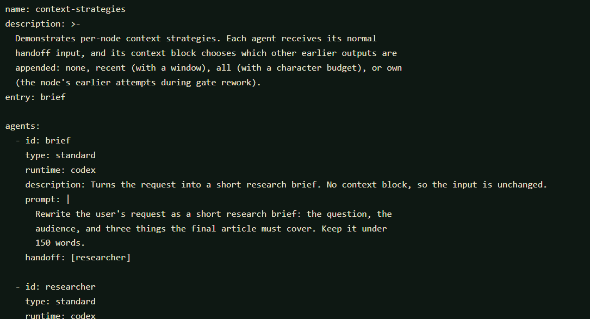

# Pipelines and agent types

[Back to SignalBox](../README.md)

## Concepts

### Agent types

| Type | Behaviour |
|------|-----------|
| `standard` | Accepts a handoff (or several; see joins below), runs its prompt against a runtime, then hands off to one or more agents or a single orchestrator. |
| `orchestrator` | A long-running coordinator. It accepts handoffs from **many** agents (fan-in: it waits until every inbound handoff has arrived), then runs its **stages** in order. Each stage dispatches to agents in parallel and collects the terminal output of every chain it started before moving on. A stage (or the orchestrator itself) can define a `prompt` to synthesise the collected results using the orchestrator's runtime. |
| `approval` | A human gate. Approval passes the payload through unchanged. Rejection follows `reject-to` when specified; otherwise it restarts work after the last upstream approved gate in the same stage/scope, or retries immediate upstream work. Reviewer notes are appended to the rework input. |
| `llm_gate` | An automated quality gate. It evaluates its input with the configured runtime and records an approve/reject decision and feedback separately from human approvals. Rejected work can be sent to `reject-to` for a bounded number of reworks. |
| `manual_edit` | Pauses for a person to edit the incoming payload in the web UI or terminal, then hands the edited text downstream. |
| `code` | Executes a local script with its input on stdin, then hands stdout to downstream nodes. No AI runtime is required. |
| `openspec` | Runs an OpenSpec CLI command in the project directory and hands stdout downstream. No AI runtime is required. See [OpenSpec integration](openspec.md#openspec-integration). |
| `session` | A multi-round discussion between participant agents. Participants take turns, each seeing the transcript, until they reach consensus or the round limit. See [Sessions and chunks](sessions.md#sessions-and-chunks). |
| `pipeline` | Runs another pipeline (or a section of it) by name as a linked child execution and hands off its final output. See [Pipeline chaining](pipeline-chaining.md#pipeline-chaining). |

### Handoffs

- A node's `handoff` list names the nodes that receive its output. Multiple
  targets run as parallel branches.
- Existing scalar targets such as `handoff: [review]` remain unconditional
  and keep their original behavior. Approval and `llm_gate` nodes can instead
  route by decision and construct downstream input from a small template:

  ```yaml
  - id: human_review
    type: approval
    handoff:
      - to: publish
        condition: on_approve
        input: "{{ output }}"
      - to: revise
        condition: on_reject
        input: |
          {{ input }}

          Reviewer feedback: {{ comment }}
  ```

  Conditions are `always`, `on_approve`, and `on_reject`, plus output-field
  comparisons on nodes with an output schema (see "Structured responses"). With no `condition`,
  a handoff keeps the legacy approval behavior (it runs after approval).
  `input` replaces the default output payload and supports only `{{ input }}`,
  `{{ output }}`, and `{{ comment }}`; it is literal text substitution, not an
  expression language. A handoff without `input` receives the node's output.
  Rejection branches can terminate or continue through acyclic routes.
  `reject-to` remains the option for routing work back through a rework loop.
- A handoff to an orchestrator must be the *sole* target.
- An agent with no `handoff` terminates its chain. Inside an orchestrator
  stage, a terminating chain hands its output back to the orchestrator;
  outside one, the output becomes a **result** of the execution.
- Chains of standard, code, approval, and manual-edit nodes can run inside orchestrator stages.
- **Joins:** when several agents hand off to the same standard, code, approval, or manual-edit
  agent, it waits for all of them and runs once on the combined input (each
  part headed `--- handoff from <agent> ---`). Joins are counted per scope:
  inside a stage, only handoffs from that stage's chains count. For example,
  two planners in a stage can both hand off to a judge, which then hands back
  to the orchestrator.
- **Manual editing:** set `type: manual_edit` on a node to pause a run and
  revise the complete incoming payload before it continues. Set `handoff` to
  the next node; the submitted text becomes that node's input. This step does
  not use a runtime or prompt.
- **Additional input:** an agent can name other nodes whose completed output
  it also needs. The engine waits for those outputs and appends each under an
  `--- additional input from <agent> ---` heading, alongside normal handoffs.
  For example, a judge can receive planner handoffs plus the original
  requirements:

  ```yaml
  - id: judge
    runtime: codex
    additional-input: [requirements_loader]
  ```
- **Formatted output:** set `format: true` on an agent to render its Markdown
  output in the execution detail view. The raw Markdown remains available in a
  collapsible section; raw HTML in Markdown is not rendered.
- **Rejection target:** an approval or `llm_gate` can set `reject-to` to rerun
  an earlier node, or start a rejection-only branch:

  ```yaml
  - id: human_review
    type: approval
    reject-to: reformatter
  - id: reformatter
    runtime: codex
    prompt: Reformat the reviewed content using the reviewer feedback.
    handoff: [human_review]
  ```

  A rejection-only branch does not run before the first review. On each
  rejection, it receives the latest reviewed payload plus the rejection notes
  and follows its handoffs back to the approval. These branches can fan out
  and join without waiting for earlier normal-flow handoffs. An earlier node
  in the normal flow instead reuses its saved input plus the rejection notes.

  Targets must be non-orchestrator nodes in the same stage/scope, with handoffs
  leading back to the rejecting gate. Normal handoff cycles remain invalid; only
  rejection routes may loop backward. Diagrams place rejection-only work and
  dashed red rejection routes above the normal track, with return connectors
  back to review. Without `reject-to`, automatic checkpoint behavior remains
  unchanged. Rejections remain visible in the execution timeline; a later
  successful review can still complete that execution.

### LLM quality gates

An `llm_gate` is a distinct automated decision step. Its `prompt` describes
the evaluation criteria; the configured runtime receives the node's input and
is instructed to return exactly one JSON object with `decision` (`approve` or
`reject`) and `feedback` (a string). Invalid verdicts fail clearly instead of
being treated as approval.

```yaml
- id: quality_review
  type: llm_gate
  runtime: codex
  prompt: Check factual accuracy and completeness.
  max_reworks: 2
  reject-to: writer
  handoff: [publish]
```

The gate passes its input onward when approved. A rejection appends its
feedback to the rework input and invokes `reject-to`; after the configured
number of reworks, another rejection ends the execution with a clear
`rework limit` error. `max_reworks` is between 0 and 10; it must be positive
when automatic gate rework is configured. The execution record and UI show
LLM verdicts and feedback independently of human approval metadata.

## Pipeline YAML

```yaml
name: default
description: Demo flow.
entry: triage

agents:
  - id: triage
    type: standard
    runtime: mock
    prompt: |
      You are the triage agent. Restate the request as a clear task brief.
    handoff: [coordinator]

  - id: coordinator
    type: orchestrator
    runtime: mock
    stages:
      - id: research
        agents: [researcher, analyst]   # run in parallel, results collected
        prompt: Merge the research notes and analysis into one summary.
      - id: drafting
        agents: [writer]
    handoff: [review]

  - id: researcher
    runtime: mock
    prompt: You are the researcher. List the key facts.

  - id: analyst
    runtime: mock
    prompt: You are the analyst. Identify risks and open questions.

  - id: writer
    runtime: mock
    prompt: You are the writer. Produce a polished draft.

  - id: review
    type: approval
    description: Human review of the draft before publishing.
    handoff: [publisher]

  - id: publisher
    runtime: mock
    prompt: You are the publisher. Format the approved draft for delivery.
```

Example pipeline YAML in the editor:



Validation catches unknown handoff, additional-input, and rejection targets;
normal handoff/dependency cycles; unreachable agents (including rejection-only
reachability); missing runtimes or script files; invalid code exit mappings;
and invalid cross-stage rejection routes. It also checks orchestrator stages,
handoff exclusivity, and stage chains that leak into another orchestrator.
Rejection loops are permitted without weakening normal cycle checks.

Two optional top-level fields support sharing. `version: 1.2.0` is the
pipeline's semantic version, used by `registry publish`. `schema: 1` declares
the pipeline schema the file was written for; a file with a newer schema than
this SignalBox understands is rejected with a request to upgrade.
