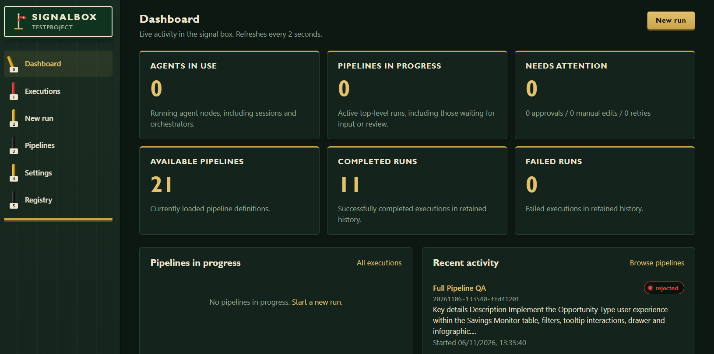
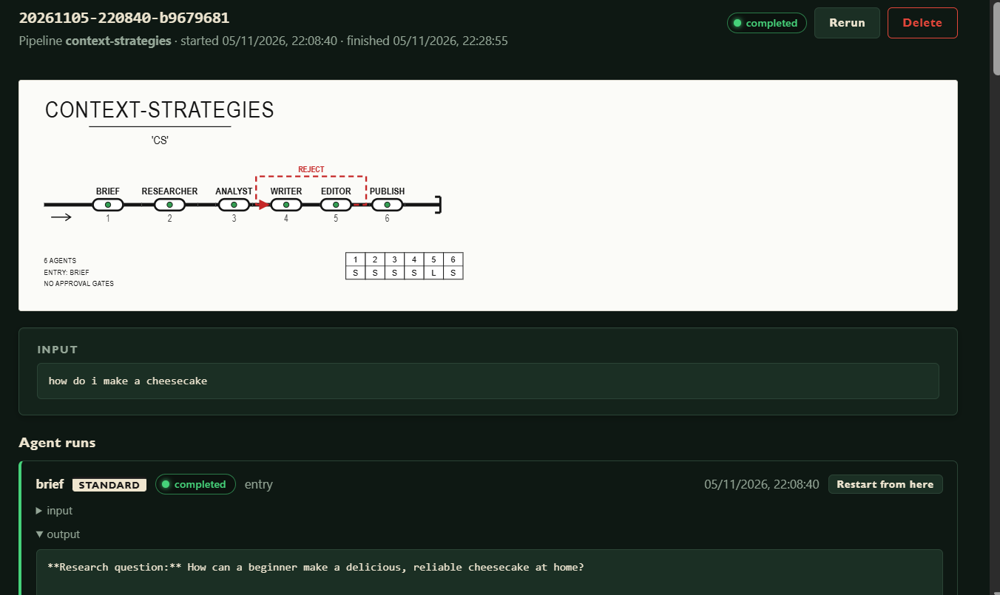

# Web UI and execution lifecycle

[Back to SignalBox](../README.md)

## The web UI (`signalbox serve`)

- **Dashboard** — the default landing page, refreshing every two seconds.
  Shows running agent nodes (including sessions, orchestrators, and LLM gates,
  but not code, human gates, or pipeline junctions), top-level pipeline runs in
  progress, approvals/manual edits/retries needing attention, and the number of
  currently loaded pipeline definitions. Linked child runs contribute to agent
  and attention counts without counting the parent pipeline twice. Completed
  and failed totals cover retained execution history (including children), not
  just the latest page. Active runs and recent activity link to execution details.

  
- **Executions** — live list of every run with status and pending-approval
  badges; click through to a per-agent timeline showing inputs, outputs,
  orchestrator stages, and errors. The execution page includes a live pipeline
  diagram, centred status lights, and automatic diagram scrolling to active
  work. Running nodes are green, failures/retry waits/rejections are red,
  waiting nodes are amber, completed nodes are green, and canceled/interrupted
  nodes are gray.

  
- **New run** — pick a pipeline, preview its agent flow, and send an input
  into it. Opening New run (or clicking it again) reloads pipeline YAML from
  disk, so added and edited pipelines are available without restarting the server.
- **Pipelines** — a searchable board of station signs for the loaded definitions.
  Choose a sign to see just that pipeline's agents, types, runtimes, handoffs,
  and stages. A searchable, scrollable submenu under **Pipelines** lets you
  switch between definitions; **All pipelines** returns to the board and schemas.
  Pipeline detail links can be bookmarked, and **Run** preselects that pipeline.
  Use **New pipeline** to create a YAML file or **Edit** on a
  pipeline to modify its source. The editor writes to the configured
  `pipelines_dir`, preserves comments/whitespace, and validates the graph,
  runtime/code references, and duplicate pipeline names before saving.
  Filenames must be `.yaml` or `.yml` files, not paths. Existing filenames are
  read-only in the editor, and a new file never overwrites an existing one.
  Stale saves are rejected if the file changed on disk. **Reload** discards a
  draft and reads the current file; drafts survive navigation between pages.
  **Edit pipeline files** remains available when malformed YAML prevents
  pipeline loading, so invalid files can be repaired. The starter template
  uses `mock`; select a runtime defined in your project when adapting it.
  Successful saves are available to new runs without restarting the server.
- **Settings** — edit the project configuration as YAML. Saving validates the
  configuration, runtime definitions, and pipeline references while preserving
  comments and whitespace. Reload reads the current file from disk; a stale
  save is rejected rather than overwriting external edits. Restart the server
  after saving to apply runtime, concurrency, watcher, and server settings.
- **Watchers** — view, add, edit, or delete configured command pollers.
  Arguments are entered as a JSON array of strings. Changes are validated
  against the project and pipeline definitions and reject stale saves. Reload
  reads the current configuration from disk. Restart the server to apply changes;
  this page shows configuration, not live poll status or activity.
- New run, Pipelines, and execution details draw pipelines as track diagrams:
  agents that run one after
  another sit on a single line, while agents that run in parallel (orchestrator
  stages and handoffs to several agents) split onto parallel tracks that rejoin
  where their outputs are collected, including at an agent that joins several
  branches.
  Rejection-only branches sit above the main flow, with dashed red rejection
  arrows and return links to existing review nodes. Diagrams scroll within
  their containers on smaller screens; navigation stacks above the content
  on mobile.
- Approval gates surface directly in the execution view with
  approve/reject buttons and an optional comment.
  Rejection follows `reject-to` if configured. Otherwise, it sends work back
  after the last upstream approved gate in the same stage/scope, or retries
  the immediate upstream agents if there is no earlier approved gate. Notes
  are appended under `--- rejection notes from <gate> ---`. Without either an
  explicit route or upstream work to retry (for example, an approval is the
  entry), rejection ends the execution.
- When a runtime call fails, that run pauses as `waiting_retry` with a
  **Retry** button; parallel branches keep running, but nothing downstream of
  the failure proceeds. Retry re-invokes the agent with the same input; use
  **Cancel** to give up. `signalbox run` prompts `retry? [y/N]` instead (with
  `--yes`, failures are not retried and the execution fails). Code nodes with
  explicit `codes` mappings instead follow their configured success, terminal
  fail, or rejection-style retry outcome as described above.
- **Rerun** starts a new execution with the same pipeline and input, using the
  pipeline definition currently on disk. **Delete** removes a finished
  execution and its stored history; cancel a running execution first.
- Session runs show their transcript grouped by round, with ✓ marks on
  agreeing turns, any chunk directives each turn applied or rejected, and a
  consensus / no-consensus banner. Diagrams draw a session as an interchange
  with one ring per participant and list the participants below it.
  Executions with chunks show a **Chunks** table; while the execution is
  running you can add chunks, mark them done, or remove them.
- Runs with a `context` strategy show a **context** section listing the
  included earlier outputs, any truncation, and the exact appended text. The
  Pipelines table and diagram tooltips show each node's strategy.
- **Registry** — browse, inspect, install, and publish versioned pipeline
  packages when a registry is configured (see [Pipeline registry](registry.md#pipeline-registry)).

Execution history is persisted in `.signalbox/executions.db`, so it survives
restarts. Existing JSON records in
`.signalbox/executions/` are imported automatically the first time the database
opens. The default retention limit is 1,000 terminal executions; set
`execution_retention` in `signalbox.yaml` to change it, or to `0` to keep
history indefinitely. In-progress executions are not pruned.
Interrupted standard-agent, code, `llm_gate`, and session cards offer **Retry from here**,
which starts a new execution at that call with its saved input, using the
current pipeline definition. Completed work that the call does not lead to is
carried into the new execution rather than repeated, and an interrupted session
resumes its transcript. Finished executions also offer **Restart from here** on
top-level runs and **Restart from this stage** on orchestrator stages; see
[Recovery and restart](execution.md#recovery-and-restart). **Rerun** starts the whole
pipeline from its original input instead.

The server has no authentication. Keep it bound to loopback or a trusted
interface; anyone with access can launch configured commands, approve work,
and edit project settings. Run only trusted pipeline definitions and scripts.

### Execution process lifecycle

Every top-level execution launched through `serve` runs in its own detached
SignalBox worker process. This includes dashboard, HTTP, MCP and CLI starts,
watcher starts, reruns, and recovery/restart actions. Child pipelines stay in
their parent's worker; workers do not start another dashboard or HTTP server.
Closing or killing `serve` does **not** cancel these executions. Runtime calls
continue, and pending approvals, manual edits and retries remain available
when you restart `serve` in the same project with the same state directory.
Use **Cancel** (or `signalbox cancel`) to stop an execution explicitly.
Watchers themselves stop with `serve`; already launched work continues.
Workers use serve's launch-time project settings and reload pipeline YAML for
new executions. Live executions keep their own definitions; restart serve to
apply changed runtime settings to future workers.

The internal `_worker` command is not a user interface: it requires a
single-use, random launch capability supplied by `serve`. Controls travel
through a private SQLite queue, not an unauthenticated worker network port.
The existing HTTP API, CLI and MCP interfaces still target `serve`, which
routes mutations to the owning worker. Launches and controls require an
acknowledgement; errors and timeouts are not reported as successful execution.
A timed-out control may already have taken effect: inspect state before
retrying it. Queue commands are never replayed after worker failure.

Workers renew a durable 30-second ownership lease and hold an OS-level lock.
Opening state from another server or a foreground `signalbox run` leaves live
owners alone. A crashed worker (released OS lock) or expired lease marks its
unfinished executions/runs **interrupted**, never completed; there is no
automatic execution replay. Classification occurs when state opens or during
the running server/workers' periodic checks. Expired owners are fenced from
further writes. Restart interrupted work explicitly using the existing
recovery actions. Runtime slots held by a paused, fenced process are retained
until its call returns or its process exits, to avoid exceeding concurrency.

Worker stdout/stderr go to `.signalbox/workers/<owner-token>.log`, independently
of the UI connection. Failed worker commands, failed runtime calls (including
automatic retries and calls awaiting manual retry), and terminal node failures
are logged with operation or execution/node/run identifiers and the error.
The `serve` console also logs HTTP error responses and abnormal worker exits
with their log paths. Logs may contain error details from external runtimes;
treat them as private project data.

Serve logs the worker PID and log path at launch; the
worker log records its execution ID. Logs and small ownership lock files are
retained for diagnosis and may be archived/removed after their workers exit;
execution-history retention does not rotate them. Protect the project state
directory as local execution data; it contains uploads and queued controls.

On Windows workers detach from the console and break away from the server's
process job. Workers and runtime subprocesses start without console windows;
their output is captured rather than shown in new terminal windows.
If a service/CI host forbids job breakaway, launch fails explicitly;
configure that host to permit it. On Unix workers start a new session.
Use an installed/built binary for long-lived service work: `go run` uses a
build-cache executable whose later removal is outside SignalBox's control.
Do not delete/move state or replace an executable still in use by workers.
Workers survive **serve** restarts, not machine shutdown, user-session teardown,
or an external supervisor explicitly killing the workers. Foreground
`signalbox run` remains attached and interactive; it does not survive its own
process terminating.
